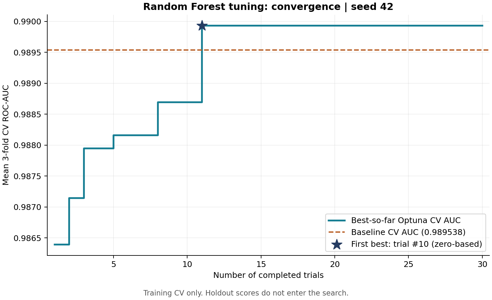
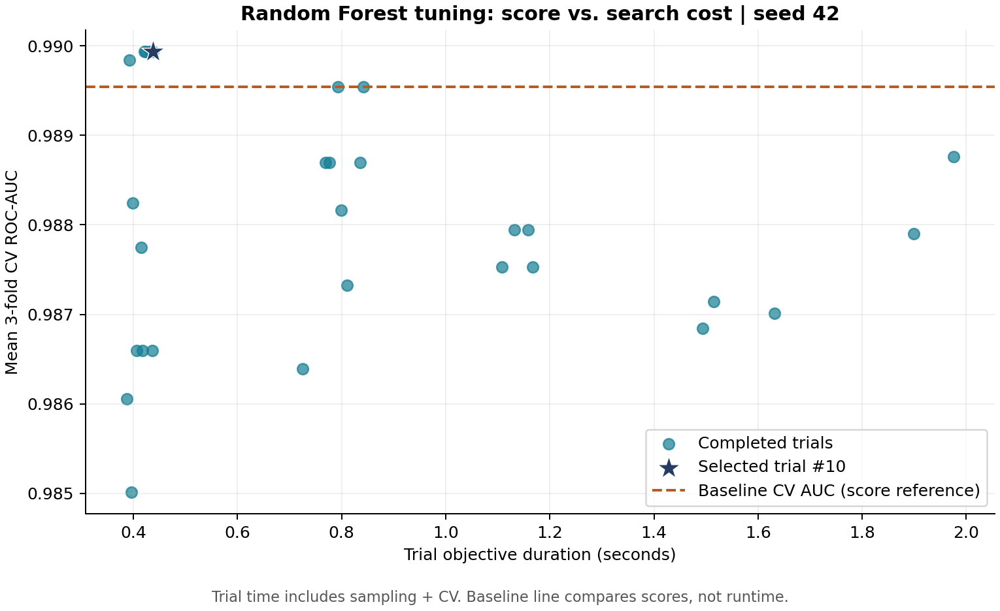

# Random Forest + Optuna Optimization

**Tối ưu siêu tham số Random Forest bằng Optuna cho bài toán phân loại** —
bài tập lớn cá nhân học phần Nhập môn Tối ưu hóa.

Repository: [huyryan220806/random-forest-optuna-optimization](https://github.com/huyryan220806/random-forest-optuna-optimization).
Tiến độ hiện tại: **S3 — đánh giá holdout & hình đã hoàn tất**. Kế hoạch, checkpoint
và hướng dẫn tiếp tục nằm ở [PROJECT_PLAN.md](PROJECT_PLAN.md). Báo cáo/slide/demo
(S4) chưa triển khai; chỉ làm khi được yêu cầu.

## Problem

Với cùng dữ liệu và các folds đánh giá, Optuna TPE có tìm được cấu hình
Random Forest có ROC-AUC CV cao hơn cấu hình mặc định không? Nếu có,
mức cải thiện đổi lấy bao nhiêu chi phí tìm kiếm, huấn luyện và suy luận?

MVP gồm một dataset, một họ mô hình và ba siêu tham số. Baseline mặc định
là mốc so sánh trung thực; kết quả tối ưu không bắt buộc phải thắng baseline.

## Optimization Formulation

Biến quyết định: `x = (n_estimators, max_depth, min_samples_leaf)`.

| Biến | Miền tìm kiếm | Baseline |
|---|---|---|
| `n_estimators` | 50, 100, 150, 200, 250 | 100 |
| `max_depth` | `None`, 4, 6, 8, 12, 16, 24 | `None` |
| `min_samples_leaf` | số nguyên 1–8 | 1 |

Hàm mục tiêu:

$$
\min_{x \in \Omega} f(x) = -\frac{1}{3}\sum_{k=1}^{3}\mathrm{ROC\!\!\!-AUC}_{k}(x)
$$

Tương đương tối đa hóa ROC-AUC trung bình qua 3 folds trên **train**.
Giữ nguyên các tham số khác theo mặc định của scikit-learn, chỉ đặt
`random_state=42`, `n_jobs=1`. Các mặc định baseline đều thuộc miền tìm kiếm.

Budget S2: **30 trials**, `TPESampler(seed=42)`; smoke test 3 trials
lưu riêng. Thời gian là chi phí cần đo/phân tích, không
phải ràng buộc cứng. Baseline không có chi phí tìm kiếm; sau này cần báo riêng
chi phí search của Optuna. Không chọn cấu hình, seed hay threshold bằng test score.

## Dataset và Method

[Breast Cancer Wisconsin (Diagnostic)](https://archive.ics.uci.edu/dataset/17/breast+cancer+wisconsin+diagnostic)
được nạp bằng `sklearn.datasets.load_breast_cancer()`; 569 mẫu, 30 đặc trưng.
Nguồn, citation, giấy phép và cách lấy dữ liệu nằm trong [data/README.md](data/README.md).
Chọn benchmark này vì có sẵn trong scikit-learn, không cần thu thập/làm sạch dữ liệu
và đủ nhỏ để hoàn thành budget HPO bằng CPU trong phạm vi bài tập.

1. Đảo nhãn: `y = (target == 0).astype(int)` → **malignant=1**, benign=0.
2. Split duy nhất bằng `train_test_split(test_size=0.2, stratify=y, random_state=42)`.
3. Dùng `StratifiedKFold(n_splits=3, shuffle=True, random_state=42)` trên train.
4. Chạy `RandomForestClassifier(random_state=42, n_jobs=1)` bằng CV tuần tự,
   ROC-AUC từ xác suất lớp malignant. Lưu từng fold, mean và std (`ddof=0`).
5. TPE đề xuất đúng ba tham số trong search space; mỗi trial tạo RF mới,
   gọi cùng hàm CV trên cùng train/folds và tối đa hóa ROC-AUC trung bình.
6. Chốt `best_params` bằng CV. S3 nạp log S2, kiểm tra params/protocol/phiên bản,
   tái dựng đúng split, fit mỗi model một lần trên toàn bộ train và đánh giá holdout.

`ExperimentConfig` trong `src/experiment.py` là nguồn cấu hình cho split/CV/RF;
`SEARCH_SPACE` là nguồn miền tìm kiếm. Mỗi run split một lần, tạo folds một lần,
rồi dùng chung cho baseline và mọi trial. Objective chỉ giữ `X_train`, `y_train`,
folds và cấu hình, không nhận đối tượng chứa holdout.

**Nguyên lý TPE:** chia các cấu hình đã thử thành nhóm có điểm tốt và nhóm còn lại,
ước lượng phân bố tham số của mỗi nhóm rồi ưu tiên ứng viên có tỷ lệ mật độ
`l(x)/g(x)` cao. Dùng Optuna 4.5.0 với **10 trials khởi tạo ngẫu nhiên**, sau đó TPE
khai thác lịch sử; các thiết lập sampler khác giữ mặc định. Smoke 3 trials chỉ
kiểm tra pipeline và chưa đi vào giai đoạn này.
Xem [tài liệu TPESampler 4.5.0](https://optuna.readthedocs.io/en/v4.5.0/reference/samplers/generated/optuna.samplers.TPESampler.html).

Study, CV và RF đều chạy tuần tự (`n_jobs=1`); không pruning, không timeout,
không enqueue baseline vào budget tìm kiếm. Trial lặp cấu hình vẫn tính vào
30 trials. Điều này giúp tái lập chuỗi đề xuất với cùng seed và phiên bản.

## Key Results — S2

<!-- S2_RESULTS_START -->
Kết quả chạy thật ngày 25/10/2026, seed 42, từ
[baseline.json](results/baseline.json), [trials.csv](results/trials.csv) và
[best_config.json](results/best_config.json). Train/holdout: 455/114 mẫu.

| Đại lượng | Baseline | Best Optuna CV |
|---|---:|---:|
| CV ROC-AUC mean ± std | 0.989538 ± 0.003436 | 0.989934 ± 0.004250 |
| `n_estimators` | 100 | 50 |
| `max_depth` | `None` | 16 |
| `min_samples_leaf` | 1 | 1 |
| Search trials | 0 | 30 COMPLETE / 0 FAIL |
| Chi phí search tăng thêm | 0 | 24.978321 giây |

Best trial là **#10** (đếm từ 0). Chênh lệch CV so với baseline:
**+0.000396 AUC**, khoảng **0.0396 điểm phần trăm**.
Baseline CV mất 0.715908 giây; chi phí search ở bảng loại trừ baseline.
Chênh lệch CV còn nhỏ; kết quả holdout và quyết định được trình bày ở phần S3 dưới đây.

Smoke có 3 trials, best CV 0.987948, được giữ riêng trong `results/smoke`.
Run tái lập 30 trials trong `results/repro` khớp toàn bộ tham số/điểm từng fold,
mean/std, trạng thái và seed với run chính, kể cả giai đoạn TPE sau 10 trials đầu.
Không yêu cầu timing giống nhau. `pytest`: **16 passed**; `pip check` không báo lỗi.
Bảng này được điền từ log run chính; cần cập nhật từ log khi chạy lại kết quả chính.
<!-- S2_RESULTS_END -->

## Key Results — S3

<!-- S3_RESULTS_START -->
Kết quả từ [final_metrics.json](results/final_metrics.json); bảng được sinh bằng
`python -m src.plots` và lưu tại [comparison.csv](figures/comparison.csv),
[comparison.md](figures/comparison.md).

| Model | CV AUC mean ± std | Test AUC | F1 | Accuracy | Balanced accuracy | Fit (s) | Predict batch (ms) | Search (s) |
|---|---:|---:|---:|---:|---:|---:|---:|---:|
| baseline | 0.989538 ± 0.003436 | 0.992890 | 0.962963 | 0.973684 | 0.964286 | 0.298146 | 9.779 | 0.000000 |
| optimized | 0.989934 ± 0.004250 | 0.994048 | 0.962963 | 0.973684 | 0.964286 | 0.147775 | 4.134 | 24.978321 |

Confusion matrix của cả hai: `[[72, 0], [3, 39]]` (hàng là nhãn thật,
cột là dự đoán; thứ tự benign=0, malignant=1). Test AUC chênh
**+0.001157**; điểm phân loại ở ngưỡng cố định không đổi.

Đã kiểm chứng 16 tests S1/S2 và 8 tests S3; các tests S3 dùng xác suất giả lập
trong thư mục tạm, không ghi vào kết quả chính. Đã xem trực tiếp cả hai PNG,
kiểm tra bảng so với JSON và sinh lại hình/bảng với nội dung giống hệt.
<!-- S3_RESULTS_END -->

Quy trình đánh giá: trước khi xem test, chọn model có CV mean cao hơn (hòa thì
giữ baseline) và ghi lựa chọn vào checkpoint. Ngưỡng cố định 0.5; xác suất bằng
0.5 chọn benign, tương ứng `argmax` của scikit-learn. Một lần `predict_proba` trên
114 mẫu holdout cung cấp xác suất cho AUC và nhãn cho F1/accuracy/confusion matrix.
Không chọn lại tham số, seed hoặc threshold bằng test score.

**Quyết định cho dự án:** giữ cấu hình Optuna đã chọn từ CV: 50 cây,
`max_depth=16`, `min_samples_leaf=1`. Nó có CV AUC nhỉnh hơn và ít cây hơn baseline.
Holdout cho AUC nhỉnh hơn nhưng F1/accuracy không đổi; cả hai cùng bỏ sót 3 mẫu
malignant. Mức tăng nhỏ, một seed và holdout 114 mẫu chưa đủ chứng minh ưu thế
thống kê hay khả năng tổng quát hóa ổn định. Chi phí tìm kiếm tăng thêm khoảng
25 giây; thời gian fit/predict đo một lần chỉ mô tả run hiện tại, không là cam kết latency.



Trục x là số trial đã hoàn thành (1–30), còn mã trial trong CSV bắt đầu từ 0.
Best xuất hiện ở trial #10, tức lần đánh giá thứ 11; đường ngang là baseline CV.



Mỗi điểm là một trial COMPLETE; ngôi sao là trial đã chọn. Trục thời gian gồm
sampling + CV + ghi metric. Baseline chỉ được vẽ thành đường tham chiếu AUC,
không đặt điểm thời gian vì baseline không có bước sampling. Trial tốn thời gian
hơn không nhất thiết có điểm tốt hơn.

## How to Run

Yêu cầu Python **3.10+**. Môi trường kiểm chứng dùng **Python 3.12.10** trên
Windows; nên dùng Python 3.12 để đối chiếu kết quả. Các dependencies runtime
được ghim phiên bản trong `requirements.txt`, gồm scikit-learn 1.7.2, Optuna 4.5.0
và matplotlib 3.10.6. CSV được ghi bằng thư viện chuẩn Python; không cần pandas.

Tại thư mục gốc repo, dùng Windows PowerShell:

```powershell
py -3.12 -m venv .venv
.\.venv\Scripts\python.exe -m pip install -r requirements.txt

# Smoke: 3 trials, lưu riêng
.\.venv\Scripts\python.exe -m src.experiment --trials 3 --seed 42 --output-dir results/smoke

# Đọc/tiếp tục đánh giá từ log chính; nếu đã xong thì dùng lại kết quả
.\.venv\Scripts\python.exe -m src.experiment --evaluate-only --input-dir results

# Sinh lại hai hình và bảng từ log, không fit model
.\.venv\Scripts\python.exe -m src.plots --input-dir results --output-dir figures

# Chỉ chạy baseline để kiểm chứng S1
.\.venv\Scripts\python.exe -m src.experiment --baseline-only --seed 42 --output-dir results/baseline-only

.\.venv\Scripts\python.exe -m pip check
.\.venv\Scripts\python.exe -m pytest -q
```

Nếu Python 3.10+ khác đang là mặc định, có thể dùng `py -m venv .venv`.
Các lệnh trên gọi thẳng Python của virtualenv nên không cần sửa ExecutionPolicy.
Sau khi activate có thể dùng `python` thay đường dẫn virtualenv. Để chạy lại toàn bộ
pipeline độc lập (chỉ xác minh tái lập, không tuning từ test), dùng thư mục riêng:

```powershell
python -m src.experiment --trials 30 --seed 42 --output-dir results/repro
python -m src.experiment --evaluate-only --input-dir results/repro
python -m src.plots --input-dir results/repro --output-dir figures/repro
```

Mặc định hiện chạy **30 trials**; muốn chỉ chạy baseline phải thêm `--baseline-only`.
CLI chấp nhận budget 1–30; khi bỏ `--output-dir`, budget dưới 30 lưu vào
`results/smoke`, baseline-only lưu vào `results/baseline-only`. Thư mục chính
`results` chỉ nhận run 30 trials với seed 42. Baseline-only từ chối ghi vào thư mục
đã có kết quả search để tránh làm lẫn cấu hình giữa các log.

Search tạo study mới, không resume study; chỉ được ghi lại log trong thư mục chưa có
`final_metrics.json`. Sau khi đã đánh giá holdout, search bị chặn để giữ nhất quán
nguồn và kết quả. Nếu thư mục repro cũng đã được đánh giá, dùng một thư mục repro mới.
Lệnh run chính S2 đã dùng là `python -m src.experiment --trials 30 --seed 42 --output-dir results`;
không cần chạy lại để xem hoặc sinh hình từ kết quả đã lưu.

`--evaluate-only` dùng seed và cấu hình trong log, không có tùy chọn đổi threshold.
Kết quả được ghi sau từng model để phục hồi khi hết quota/gián đoạn. Chạy lại cùng
nguồn sẽ bỏ qua model đã xong; nếu hoàn tất thì đọc lại kết quả, không fit/predict lần nữa.
SHA-256 nguồn chuẩn hóa xuống dòng LF để dùng được sau Git checkout trên Windows/Linux.
Nếu nội dung log đã thay đổi, lệnh từ chối trộn kết quả. Tiến độ phiên nằm ở mục 12 kế hoạch.

## Logging

- `baseline.json`: tham số RF mặc định, CV từng fold/mean/std, thời gian, seed,
  split/CV, môi trường/phiên bản. `n_trials` là budget của run chứa baseline;
  `baseline_search_trials=0` nói rõ baseline không tốn budget tìm kiếm.
- `trials.csv`: một dòng/trial, `trial_number` bắt đầu từ **0**. Ghi các cột
  `trial_number, n_estimators, max_depth, min_samples_leaf, cv_auc_mean,
  cv_auc_std, duration_sec, state, seed, cv_duration_sec, cv_auc_folds, error`.
  `max_depth=None` lưu bằng chuỗi **`None`**; trong JSON dùng `null`.
  `cv_auc_folds` là mảng JSON trong ô CSV. Độ lệch chuẩn dùng `ddof=0`.
- `best_config.json`: cấu hình tốt nhất trong các trial COMPLETE, đầy đủ tham số
  RF để tái dựng, CV mean/std/từng fold, số trial, search space, sampler, seed,
  split/CV, môi trường, thời gian search và mức chênh CV so với baseline.
- `final_metrics.json`: trạng thái checkpoint, nguồn S2 và SHA-256, lựa chọn theo CV,
  metric holdout của baseline/optimized, confusion matrix, params, timing và metadata.
  `models` được bổ sung từng model; `status=complete` khi cả hai đã xong.
- `figures/comparison.csv` và `comparison.md`: bảng được sinh lại từ final_metrics.json.
  Ba log S2 giữ nguyên; cờ `holdout_evaluated=false` trong log S2 phản ánh giai đoạn
  search, còn kết quả S3 có `holdout_evaluated=true`.

CSV được cập nhật sau từng trial; CSV/JSON được ghi qua tệp tạm rồi thay thế.
Nếu trial lỗi, log ghi `FAIL`, thông báo `error`, để trống điểm CV và chương trình
dừng với mã lỗi. `best_config.json` có `status=incomplete`, chỉ tham chiếu các
trial đã COMPLETE (hoặc `null` nếu chưa có); không coi đây là run nghiệm thu.
Không retry ngoài budget hoặc thay đổi search space khi có lỗi.

JSON ghi đầy đủ tham số RF, seed, quy tắc nhãn, split/CV, điểm từng fold,
mean/std, phiên bản và môi trường. Các thời gian tổng dùng `time.perf_counter()`:
`baseline.duration_sec` và `trials.cv_duration_sec` cùng đo 3-fold CV, gồm fit,
scoring và overhead; `trials.duration_sec` còn gồm đề xuất tham số, tạo model và ghi metric.
`search_duration_sec` đo toàn bộ `study.optimize`, gồm các lần ghi CSV, loại trừ
baseline. Thời gian fit/score từng fold trong baseline do scikit-learn trả về.
S3 ghi riêng `fit_duration_sec` trên toàn bộ train và `inference_duration_sec` của
một batch holdout. `inference_sec_per_sample` là thời gian batch chia số mẫu, không
phải latency từng request độc lập. Timing phụ thuộc máy/tải hệ thống và không yêu cầu
giống hệt khi chạy lại. JSON không chấp nhận NaN/Infinity.

## Repository Structure

```text
.
├── PROJECT_PLAN.md          # Đặc tả và tiến độ làm việc
├── README.md
├── requirements.txt
├── .gitignore
├── .gitattributes
├── src/
│   ├── __init__.py
│   ├── experiment.py        # Baseline, TPE, logging, final evaluation
│   └── plots.py             # Hai hình và bảng sinh từ log
├── data/README.md           # Nguồn và quy tắc nhãn
├── results/
│   ├── baseline.json        # Baseline của run chính
│   ├── trials.csv           # 30 trials của run chính
│   ├── best_config.json     # Cấu hình chọn bằng CV
│   └── final_metrics.json   # Holdout và timing, checkpoint tiếp tục
├── tests/                  # Protocol, logging, metrics, resume, plots
├── figures/                # Hai PNG và comparison.csv / comparison.md
├── report/README.md         # S4
└── plans/                  # Tài liệu đầu vào; PDF giữ cục bộ
```

## Limitations

Hiện chỉ có một seed và một dataset nhỏ; std giữa các folds không phải độ bất định
qua nhiều lần chạy độc lập. Best CV chịu ảnh hưởng của việc chọn cấu hình từ nhiều
lần thử; holdout chỉ là một lần kiểm tra trên 114 mẫu. Dataset phục vụ benchmark học thuật, không chứng
minh khả năng chẩn đoán lâm sàng. Không triển khai ứng dụng web hoặc mô hình khác.

## AI assistance

Codex hỗ trợ tạo cấu trúc, baseline/Optuna/evaluation/plots, tài liệu và chạy các kiểm tra
ghi trong nhật ký S1–S3. Đây là kiểm chứng do công cụ thực hiện; phần người học tự
chạy, đọc hiểu code và giải thích kết quả cần được người học bổ sung sau khi làm.
