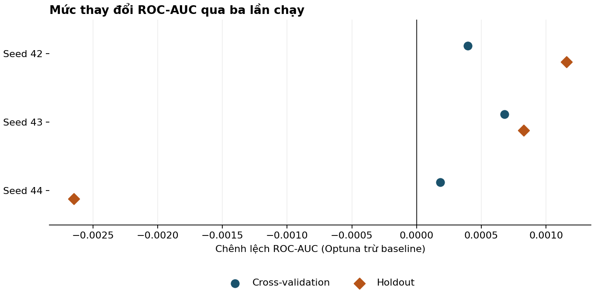

# Minh chứng ba lần chạy Random Forest và Optuna

Ngày 25/11/2026, Codex đã chạy lại toàn bộ thí nghiệm trên máy dự án với ba seed chọn trước **42, 43 và 44**. Mỗi lần khởi động một Optuna study mới, đánh giá baseline và thử 30 cấu hình bằng 3-fold CV trên train. Sau khi chốt cấu hình bằng CV, chương trình đánh giá baseline và cấu hình đó trên holdout. Tổng cộng có **3 lần chạy, 90 trials hoàn tất, 0 trials lỗi**.

## Nhật ký chạy thật

Giờ trong bảng là giờ Việt Nam (UTC+7), lấy từ lúc gọi lệnh search đến khi lệnh đánh giá holdout kết thúc. Mở **Console** để xem lệnh, mã study, thời điểm từng trial và mã thoát của cả hai lệnh. Mở **30 trials** để xem tham số và ba điểm fold của từng lần thử.

| Seed | Bắt đầu – kết thúc (UTC+7) | Dấu vết thực thi | Điểm holdout |
|---:|---|---|---|
| 42 | 16:35:58 – 16:36:35 | [Console](seed-42/console.log) · [30 trials](seed-42/trials.csv) · [Cấu hình](seed-42/best_config.json) | [Kết quả](seed-42/final_metrics.json) |
| 43 | 16:36:35 – 16:37:10 | [Console](seed-43/console.log) · [30 trials](seed-43/trials.csv) · [Cấu hình](seed-43/best_config.json) | [Kết quả](seed-43/final_metrics.json) |
| 44 | 16:37:10 – 16:37:49 | [Console](seed-44/console.log) · [30 trials](seed-44/trials.csv) · [Cấu hình](seed-44/best_config.json) | [Kết quả](seed-44/final_metrics.json) |

## Kết quả

Chênh lệch Δ bằng ROC-AUC của cấu hình Optuna trừ ROC-AUC của baseline trong cùng lần chạy. Các số trong bảng được làm tròn đến sáu chữ số thập phân. [Bảng số liệu gốc](summary.csv)

| Seed | CV baseline | CV Optuna | Δ CV | Test baseline | Test Optuna | Δ test |
|---:|---:|---:|---:|---:|---:|---:|
| 42 | 0.989538 | 0.989934 | +0.000396 | 0.992890 | 0.994048 | +0.001157 |
| 43 | 0.988579 | 0.989256 | +0.000677 | 0.986938 | 0.987765 | +0.000827 |
| 44 | 0.994360 | 0.994542 | +0.000182 | 0.972222 | 0.969577 | −0.002646 |



Optuna đạt CV AUC cao hơn baseline ở cả ba seed. Trên holdout, AUC tăng ở seed 42 và 43, giảm ở seed 44. Chênh lệch trung bình ± độ lệch chuẩn mẫu giữa ba seed là **+0.000418 ± 0.000248** trên CV và **−0.000220 ± 0.002107** trên holdout. F1 của hai mô hình bằng nhau trong từng seed. Ba lần chạy cho thấy lợi ích về AUC trên holdout phụ thuộc vào lần chia dữ liệu.

Seed của pipeline điều khiển cả train/test split, các folds, Random Forest và bộ lấy mẫu TPE. Do đó kết quả phản ánh biến động của **toàn bộ quy trình**. Các tập holdout lấy từ cùng 569 mẫu nên có thể chồng lặp. Mã chạy và phiên bản thư viện dùng cho cả ba lần đều theo [bản v1.0](https://github.com/huyryan220806/random-forest-optuna-optimization/tree/v1.0).

## Cách đối chiếu khi bảo vệ

Ví dụ với seed 44, tìm `Trial 18 finished` trong console, rồi tìm dòng `trial_number=18` trong CSV. Cả hai ghi cấu hình **100 cây, độ sâu 8, lá tối thiểu 2**. Trong `best_config.json`, cấu hình này có CV AUC **0.994542**. Trong `final_metrics.json`, trường `selection.uses_holdout` bằng `false` và test AUC của cấu hình là **0.969577**. Đây là một trường hợp mà điểm CV tăng nhưng điểm test giảm.

Đã đối chiếu đủ 90 điểm trial giữa console và CSV, tính lại winner từ CSV và kiểm tra SHA-256 của các log nguồn trong từng kết quả holdout. Riêng lần mới với seed 42 tái tạo đúng toàn bộ chuỗi tham số, điểm từng fold và các metric holdout của lần chạy chính ngày 25/10/2026. Hai lượt có nhật ký thực thi và thời gian đo riêng.

## Tự chạy trước mặt giảng viên

Từ thư mục gốc repo với môi trường đã cài theo README, lệnh đầu tạo một bộ log mới trên máy người chạy và in ra thư mục của từng seed. Lệnh sau kiểm tra log, tính bảng và vẽ hình. Chọn tên thư mục mới mỗi lần để giữ lại bằng chứng cũ.

```powershell
.\.venv\Scripts\python.exe scripts/repeat_experiment.py results/repro/tu-chay-01
.\.venv\Scripts\python.exe -m scripts.summarize_runs results/repro/tu-chay-01
```

Có thể mở `seed-42/console.log` trong khi lệnh đầu chạy để theo dõi từng trial. Thư mục `results/repro/` được gitignore và giữ log tự chạy trên máy. [Mã chạy ba seed](../../../scripts/repeat_experiment.py) · [Mã đối chiếu và dựng bảng/hình](../../../scripts/summarize_runs.py)
